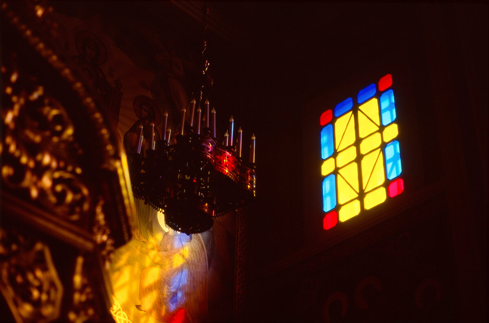
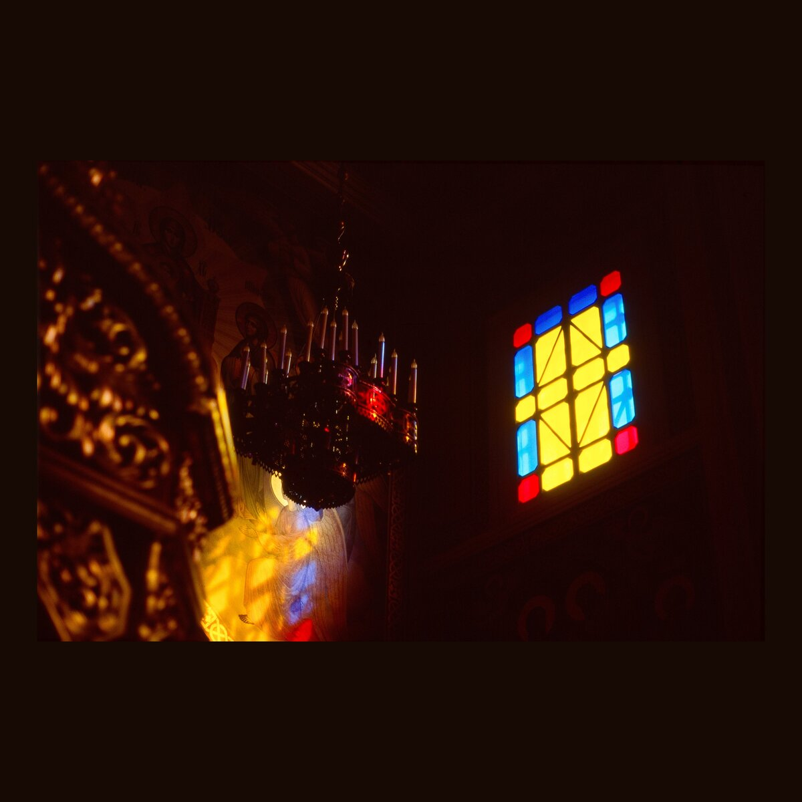
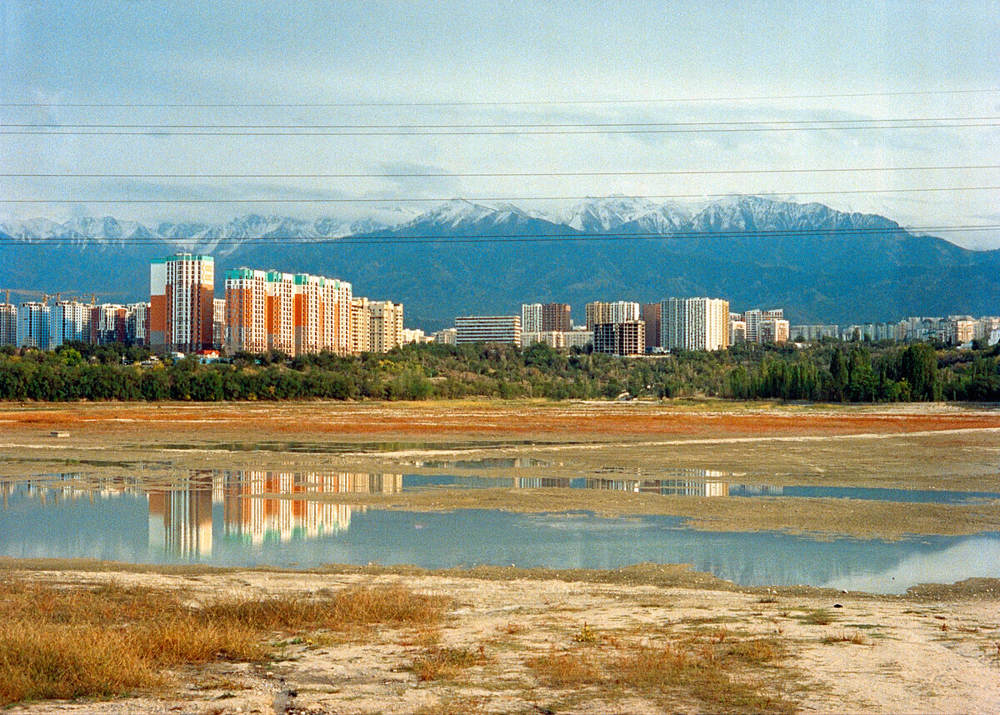
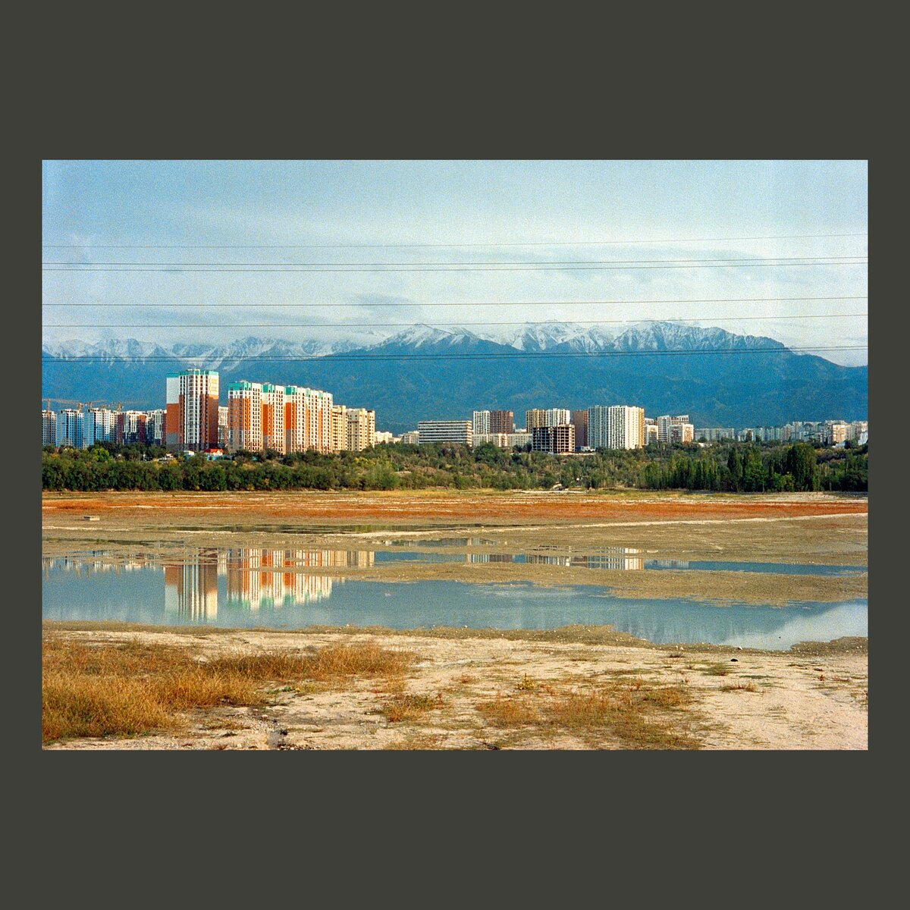

# image-border


**A small command-line tool that turns images into square posts, with a border coloured to match each image.**

| Before | After |
| :---: | :---: |
|  |  |
|  |  |

---

## How It Works

For every image passed on the command line, the tool:

1. **Samples the colour:** reads `n` random pixels (default `2000`) and averages their RGB values.
2. **Darkens it:** divides the average by a darken factor (default `2.5`), which gives a muted tone that matches the image.
3. **Scales and centres:** scales the image so its longer side fits a `4320 × 4320` canvas with a `400 px` border (`200 px` on each side), then centres it along the shorter side.
4. **Renders and saves:** draws the image onto the coloured background with SFML and saves the result as `<name>_border.<ext>`.

Random sampling keeps it fast even for very large scans, and the result is close enough to the true average for a background colour.

> [!WARNING]
> After the bordered version is saved, the **original file is deleted**. Files that already end in `_border` are skipped, so running the tool twice on a folder is safe.

---

## Prerequisites

* **Compiler:** GCC or Clang with C++17 support
* **Build System:** GNU Make
* **Library:** [SFML 3](https://www.sfml-dev.org/) (graphics and system modules)

```bash
sudo pacman -S sfml        # Arch
```

---

## Building and Running

```bash
git clone https://github.com/FelixKimmerle/image-border.git
cd image-border
make release
./build/release/border photo1.jpg photo2.jpg
```

To build with a different compiler, pass it to make (run `make clean` first when switching):

```bash
make clean
make release CXX=clang++
```

Or process a whole folder:

```bash
./build/release/border /path/to/photos/*.jpg
```

---

## Configuration

The parameters are constants in [`src/main.cpp`](src/main.cpp):

| Parameter | Default | Description |
| --- | --- | --- |
| `TARGET_WIDTH` / `TARGET_HEIGHT` | `4320` | Output canvas size in pixels |
| `BORDER` | `400` | Total border on the longer side |
| `samples` | `2000` | Number of random pixels averaged for the colour |
| `darken` | `2.5` | Divisor applied to the averaged colour |
